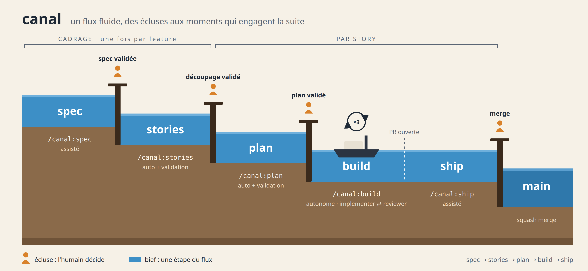

# Le workflow canal

canal guide un flux de travail fluide vers un résultat structuré. Les agents avancent seuls
là où c'est sûr, et l'humain reprend la main aux « écluses » : les moments où une décision
engage la suite.



## Vue d'ensemble

```
CADRAGE (une fois par projet / par feature)
  /canal:setup          [assisté]  configure le projet (commandes, labels, AGENTS.md)
  /canal:spec           [assisté]  interview → docs/specs/<slug>.md          ◆ écluse : spec validée
  /canal:stories        [auto]     découpe la spec en stories                ◆ écluse : découpage validé
                                   → issues GitHub (label story + status:ready)

PAR STORY
  /canal:plan <issue>   [auto]     agent planner : analyse + plan            ◆ écluse : plan validé
                                   → branche story/<n>-<slug> + docs/plans/<n>-<slug>.md
  /canal:build <issue>  [AUTO]     implementer ⇄ reviewer (max 3 tours)
                                   jusqu'à 0 finding bloquant → push + PR
  /canal:ship <issue>   [assisté]  synthèse PR + CI                          ◆ écluse : merge
                                   → squash merge, issue fermée

UTILITAIRES
  /canal:fix "<desc>"   [assisté]  petite correction sans plan, revue légère, PR
  /canal:status         [auto]     état du flux et prochaine action
```

## Les écluses (gates humains)

| Écluse | Où | Ce que l'humain décide |
|---|---|---|
| Spec | `/canal:spec` | Le besoin est-il bien compris et bien borné ? |
| Découpage | `/canal:stories` | Les stories sont-elles livrables indépendamment, dans le bon ordre ? |
| Plan | `/canal:plan` | L'approche technique est-elle la bonne ? **Aucun code sans plan validé.** |
| Merge | `/canal:ship` | Le résultat est-il acceptable en production ? **Aucun merge sans accord explicite.** |

Entre la validation du plan et l'ouverture de la PR, tout est autonome. Si le build ne
converge pas, ou si le plan s'avère irréalisable, le flux s'arrête (`status:blocked`) et rend
la main à l'humain.

## Les agents

| Agent | Rôle | Accès |
|---|---|---|
| `planner` | Explore le code, rédige le plan d'une story | lecture seule |
| `implementer` | Exécute le plan en TDD, commit par étape, lance les vérifications | lecture + écriture |
| `reviewer` | Revue en contexte vierge : conformité au plan, correction, tests, sécurité | lecture seule |

L'orchestration est faite par les commandes elles-mêmes (pas d'agent orchestrateur).

## États d'une story (labels GitHub)

```
status:ready → status:planned → status:building → status:review → (fermée)
                                       ↘ status:blocked ↙
```

| Label | Signification | Prochaine commande |
|---|---|---|
| `story` | L'issue est une story du workflow | — |
| `status:ready` | Story rédigée, à planifier | `/canal:plan <n>` |
| `status:planned` | Plan validé, branche créée | `/canal:build <n>` |
| `status:building` | Build en cours | — |
| `status:review` | PR ouverte, en attente de l'humain | `/canal:ship <n>` |
| `status:blocked` | Intervention humaine requise (voir dernier commentaire) | selon le cas |

## Artefacts dans le projet

| Chemin | Contenu |
|---|---|
| `AGENTS.md` | Règles du workflow + commandes de vérification du projet (bloc `canal`) + conventions |
| `CLAUDE.md` | Importe `AGENTS.md` (`@AGENTS.md`) |
| `docs/specs/<slug>.md` | Spécifications fonctionnelles |
| `docs/plans/<n>-<slug>.md` | Plan de chaque story, versionné dans sa PR |

## Conventions

- Branches : `story/<n>-<slug>` pour une story, `fix/<slug>` pour un quick fix.
- Commits : Conventional Commits, référençant l'issue (`feat(cart): ajoute la remise #42`).
- PR : `Closes #<n>`, résumé, lien vers le plan, rapport de revue, résultat des vérifications.
- Merge : squash, suppression de la branche.

## Reprise après retours humains

Si l'humain demande des modifications au moment du `/canal:ship`, ses retours sont postés en
commentaire de PR. Un nouveau `/canal:build <n>` les reprend comme findings du premier tour.

## Compatibilité

Les commandes sont des skills au format ouvert `SKILL.md`, et les règles vivent dans
`AGENTS.md`. Seuls les agents (`plugin/agents/`) sont propres à Claude Code : sans
sous-agents, chaque skill indique comment jouer le rôle en séquence.
